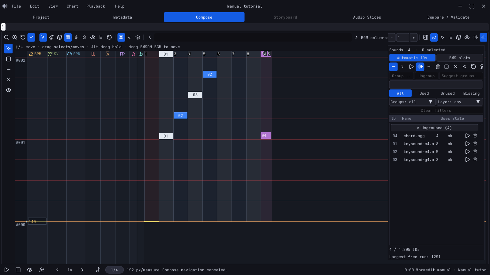

# wormedit

**A rhythm chart editor for BMS, BMSON, StepMania and osu!mania, built for charting fast.**



> **Status: pre-release (0.1.0).** Wormedit is used to make real charts, but it is not finished and
> has no stable release yet. Storyboards, Lua scripting and Quaver support are planned but not
> shipped. Work is tracked as task cards in [`docs/chart-editor-plan/`](docs/chart-editor-plan.md).

## How charting works

Wormedit is a _hybrid_ editor. The mouse-driven drawing and keysounding of BMS editors such as
iBMSC and BMSE, and the keyboard-driven cursor, snaps and lane keys of the StepMania editor, work
on the same canvas at the same time:

1. Arm a sound: double-click it in the Sounds dock, or press `Ctrl+K` and type its name.
2. Walk the chart with the arrow keys, one snap at a time (`Left`/`Right` change the snap,
   `PgUp`/`PgDn` skip a measure, holding `Tab` moves faster).
3. Press a lane key to place the armed sound at the cursor; hold it while moving for a long note.
4. Fix with the mouse: drag to move, `Alt`-drag to lengthen a note, right-drag to erase.

Everything else is one search away in the command palette (`Ctrl+Shift+P`), which shows each
command's shortcut as it finds it. The [user manual](docs/manual/chapters/the-wormedit-way.adoc)
teaches this loop first.

## Concepts

- A **project** (`.wormedit`) holds the song, its sounds and images, and one or more **charts**
  (difficulties). Saving always writes the project.
- **Output groups** turn a project into game files: each group names a format (BMS, BMSON, osu!mania,
  StepMania `.sm`/`.ssc`), the charts it includes and where to write them. One chart can export to
  several formats; conversions report what a format cannot store instead of dropping it silently.
- **Sounds** are keysounds, BGM and the song audio; BMS charts can also address exact `#WAV` slots.
- **Layers** are your own colored tags on notes (vocals, kick, a synth line) for finding, hiding
  and editing parts of a dense chart. They live in the project, not in exported files.

## What it does

- **Editing.** Lane keys and keyboard holds, mouse drawing and painting, area selection,
  cut/copy/paste with previews, moving notes between lanes and into BGM, select-by-sound, note
  kinds (mines, lifts, fakes, rolls, invisible notes) where the format has them, and default lane
  keys for most layouts, including BMS double play and osu!mania up to 18K.
- **Measures and timing.** Exact (rational) positions; BPM, stops, delays, warps, scroll velocity,
  StepMania speeds and osu!mania kiai in timing lanes beside the notes; bar lines you split, merge
  and move like notes (`Ctrl+M` toggles one at the cursor); tap tempo, waveform beat fitting, a
  metronome, timing lock and SV recipes.
- **Audio.** Streaming playback with waveforms, per-note audition, BGM lane mute and solo,
  playback from 0.1× to 1×, with or without pitch change.
- **BMS depth.** Legacy Shift-JIS and other encodings, `#RANDOM`/`#IF`/`#SWITCH` branches, BGM
  columns, numbered `#WAV` slot import, and paste from **iBMSC and BMSE** (and tools that write
  their clipboard format).
- **Checking.** Side-by-side difficulty comparison, validation that jumps to the problem, an
  in-editor player preview and launching an external player.
- **Safety.** Atomic saves, autosave and crash recovery; edits are undoable.

## Formats

| Format | Files | Notes |
| --- | --- | --- |
| BMS family | `.bms` `.bme` `.bml` `.pms` | Lane-profile detection (BME 7K/14K, PMS 5/9-button); unchanged sections keep their original bytes; edited files are written as UTF-8 by default |
| BMSON | `.bmson` | Exact resolution, variable bar lines, sound-channel slices and stems, BGA |
| StepMania | `.sm` `.ssc` | Several difficulties per file; dance, pump and other step types of 3 to 8 and 10 columns; StepMania 5.1 and Etterna export targets; keysounds |
| osu!mania | `.osu` | 1K to 18K; osu! file format v14 (stable) and v128 (lazer) |

Wormedit opens all of these and exports them through output groups. A headless converter,
`wormedit-convert`, runs the same conversions from a JSON request.

## Getting wormedit

There are no prebuilt downloads yet; build from source. Wormedit is developed on Linux. Windows
builds are cross-compiled with MinGW-w64 and packaged as a ZIP by
`scripts/windows-cross-package.sh`. CI builds and tests the headless core on Linux (GCC and Clang)
and macOS.

```sh
git clone --recurse-submodules https://github.com/zardoru/wormedit.git
cd wormedit
cmake -S . -B build -G Ninja
cmake --build build
./build/wormedit
```

The application needs CMake 4.2 or newer (for the [`libotoworm`](https://github.com/zardoru/libotoworm)
submodule), a C++23 compiler and zlib (and iconv outside Windows). SDL3, Nuklear and the other
libraries are fetched by CMake. FFmpeg development libraries, if present, add video previews and
audio metadata. [Asciidoctor](https://asciidoctor.org) builds the HTML manual that `cmake --install`
ships; configure with `-DWORMEDIT_INSTALL_MANUAL=OFF` to skip it.

The headless core and its tests need no window or GPU:

```sh
cmake --preset headless && cmake --build --preset headless && ctest --preset headless
```

Offline builds, cross-compiling, Windows packaging and crash backtraces are covered in
[`docs/building.md`](docs/building.md).

## Documentation

- **[User manual](docs/manual/)** (AsciiDoc; `cmake --build build --target manual` renders it to
  HTML in `build/manual/`): the charting loop, navigation, timing, sounds and
  layers, bar lines, walkthroughs for a keysounded BMS chart and for an osu!mania/StepMania chart,
  and generated keyboard and layout references.
- [Building](docs/building.md)
- [Format references](docs/references/)

## Contributing

Start with [`docs/architecture.md`](docs/architecture.md) (the edit pipeline) and
[the code style](docs/chart-editor-plan/decisions/code-style.md).

| Path | Contents |
| --- | --- |
| `include/wormedit`, `src/core` | UI-free document model, timing, commands and editing |
| `src/formats` | BMS, BMSON, StepMania, osu!mania and native project codecs |
| `src/audio`, `src/visual` | Decoding, playback, waveforms, time-stretch; image and video previews |
| `src/sys` | Application shell: views, commands, jobs, preferences |
| `src/ui` | Nuklear frontend and the GPU field renderer |
| `src/tools` | `wormedit-convert` and the manual reference generator |
| `tests/` | Catch2 tests and the windowless [frontend event harness](docs/frontend-event-harness.md) |
| `docs/` | Manual, plan and task cards, building guide, format references |

`scripts/gate.sh` builds, runs the whole suite (over 4,000 tests), and checks function complexity
and whitespace; run it before sending a change.

## AI-assisted development

Most of wormedit's code, tests and documentation are written by AI coding agents (Claude and
Codex), working from requirements, designs and reviews by the project's author, who sets the
direction and accepts or rejects every change.

## License and credits

Public domain under [The Unlicense](LICENSE). Bundled and fetched dependencies keep their own
licenses, among them SDL3, Nuklear, miniaudio, stb, zlib, Catch2, nlohmann/json, Lua and, when
enabled, FFmpeg (LGPL).

- The Nuklear SDL3 backend in `src/ui/nuklear/sdl_backend.cpp` is adapted from Nuklear's
  `demo/sdl3_renderer` and keeps its MIT notice.
- [`libotoworm`](https://github.com/zardoru/libotoworm) (MIT) is a separate project, included as
  the `third_party/libotoworm` submodule under its own license.
